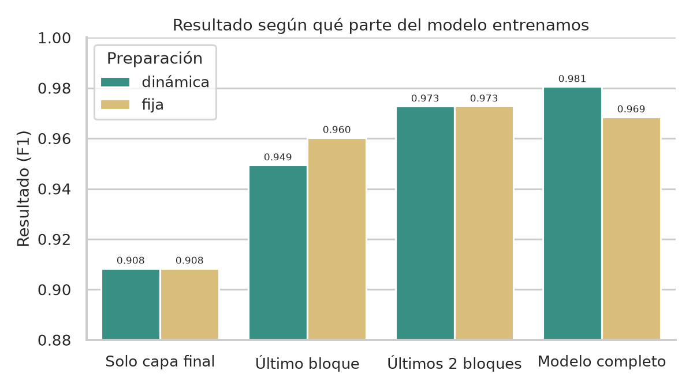

# llms-from-scratch

Un GPT escrito desde cero en PyTorch. La idea era entender por dentro cómo
funciona un LLM, así que aquí no se usa nada tipo `transformers`: la atención,
los bloques del transformer, el bucle de entrenamiento y el muestreo de texto
están implementados en este repo.

Sobre esta misma arquitectura se pueden cargar los pesos oficiales de GPT-2 o
entrenar modelos propios con corpus en español (viene el Quijote incluido).
Funciona en CPU, GPU y TPU, y en Colab reutiliza el torch que ya trae el
runtime.

## Qué incluye

- Modelo decoder-only con embeddings de tokens y posición, atención
  multi-cabeza con máscara causal, feed-forward con GELU (aproximación `tanh`,
  como usa GPT-2) y bloques pre-LayerNorm con conexiones residuales.
- Entrenamiento con AdamW, warmup lineal y decaimiento coseno, gradient
  clipping y precisión mixta (bf16/fp16) en CUDA. Por época guarda `last.pt`
  y, si mejora la validación, `best.pt`. Se puede reanudar desde un checkpoint.
- Splits de train/valid/test, con pérdida y perplexity reportadas por época.
- Generación con muestreo por temperature y top-k, modo greedy y semilla
  opcional.
- Carga de los pesos oficiales de GPT-2 (`gpt2`, `gpt2-medium`, `gpt2-large`,
  `gpt2-xl`) de Hugging Face sobre nuestra implementación.
- Dos tokenizers a elección: el de GPT-2 (`tiktoken`) o un BPE byte-level
  propio entrenado con 🤗 `tokenizers`. El vocabulario se ajusta solo.
- Fine-tuning de clasificación spam/ham sobre GPT-2: linear probe, últimos
  bloques o modelo completo, padding dinámico o fijo y barrido automático de
  configuraciones con métricas de accuracy, precision, recall y F1.
- Descargador de libros en español desde Project Gutenberg. El corpus que
  genera lo usa el entrenamiento automáticamente.

## Arquitectura

El flujo completo, de tokens a logits:

```
        tokens
          │
          ▼
  ┌────────────────────────────────┐
  │  Token Emb. + Pos. Emb.        │
  │           └──▶ Dropout         │
  └────────────────────────────────┘
          │
          ▼
  ┌────────────────────────────────────────────┐
  │  Bloque Transformer × N   (pre-LayerNorm)  │
  │                                            │
  │   x ─▶ LayerNorm ─▶ Multi-Head Causal Attn │
  │   │                                │       │
  │   └──────────── (+) ◀─────────────┘        │
  │   │                                        │
  │   ├─▶ LayerNorm ─▶ FFN (GELU tanh)         │
  │   │                            │           │
  │   └─────────── (+) ◀───────────┘           │
  └────────────────────────────────────────────┘
          │
          ▼
  LayerNorm final ─▶ Linear (vocabulario) ─▶ logits
```

## Configuraciones del modelo

| Config | `emb_dim` | Capas | Cabezas | Contexto | Parámetros | Pensado para |
|:------:|:---------:|:-----:|:-------:|:--------:|:----------:|--------------|
| `micro` | 128 | 4 | 4 | 256 | 13,7 M | pruebas rápidas en CPU |
| `t4` | 256 | 6 | 8 | 256 | 30,5 M | GPU T4 de Colab (16 GB) |
| `small` | 768 | 12 | 12 | 1 024 | 163 M | ≈ GPT-2 small |
| `conventional` | 768 | 12 | 12 | 1 024 | 163 M | referencia GPT-2 |

El vocabulario por defecto es el de GPT-2 (50 257 tokens). Si entrenas con un
tokenizer propio, `vocab_size` se ajusta al tamaño real de su vocabulario.

## Instalación

Hace falta Python 3.12 y [uv](https://docs.astral.sh/uv/) (si no lo tienes:
`curl -LsSf https://astral.sh/uv/install.sh | sh`). El script de instalación
detecta si estás en Colab: ahí no crea entorno virtual y usa el torch del
runtime. En local crea el `.venv` con uv e instala todo lo que hay en
`pyproject.toml` (PyTorch, tiktoken, tokenizers, pandas, safetensors).

```bash
git clone git@github.com:d0ubt0/llms-from-scratch.git
cd llms-from-scratch
./scripts/setup.sh
```

## Uso

El flujo típico es entrenar y luego generar con el checkpoint que salga:

```bash
./scripts/train.sh --epochs 3
./scripts/generate.sh "En un lugar de la Mancha"
```

### Entrenar

```bash
./scripts/train.sh --epochs 5 --batch-size 8
./scripts/train.sh --config t4 --device cuda       # GPU
./scripts/train.sh --resume checkpoints/last.pt    # reanudar
```

Por defecto entrena sobre `data/corpus_es.txt` si existe y, si no, sobre
`data/don_quijote.txt`. Se puede configurar con variables de entorno (todas
tienen su flag equivalente; ver `--help`):

| Variable | Descripción | Por defecto |
|----------|-------------|-------------|
| `DATA` | Corpus de entrenamiento (`.txt`, `.csv` o `.json`) | `data/corpus_es.txt` si existe, si no `data/don_quijote.txt` |
| `CONFIG` | `micro` \| `t4` \| `small` \| `conventional` | `micro` |
| `DEVICE` | `auto` \| `cpu` \| `cuda` \| `xla` | `auto` |
| `EPOCHS` | Número de épocas | `1` |
| `BATCH_SIZE` | Tamaño de batch | `4` |
| `TOKENIZER` | Ruta a un `tokenizer.json` propio | GPT-2 (`tiktoken`) |
| `OUT_DIR` | Carpeta de checkpoints | `checkpoints` |

Cada checkpoint guarda también la configuración del modelo y la ruta al
tokenizer, así que después no hay que volver a indicarlos.

### Generar texto

```bash
./scripts/generate.sh "Había una vez" --max-new-tokens 100 --temperature 0.9
./scripts/generate.sh "Hola" --greedy     # siempre elige el token más probable
./scripts/generate.sh "Hola" --seed 42    # resultado reproducible
```

| Variable | Descripción | Por defecto |
|----------|-------------|-------------|
| `CHECKPOINT` | Ruta al `.pt` | `checkpoints/best.pt` o `last.pt` |
| `TOKENIZER` | `tokenizer.json` a usar | el guardado en el checkpoint |
| `DEVICE` | `auto` \| `cpu` \| `cuda` \| `xla` | `auto` |
| `MAX_NEW_TOKENS` | Tokens a generar | `200` |
| `TEMPERATURE` | Temperatura de muestreo | `0.8` |
| `TOP_K` | Filtrado top-k | `40` |
| `SEED` | Semilla | aleatoria |

### Pesos oficiales de GPT-2

Con `--pretrained` se usa un GPT-2 de Hugging Face sin entrenar nada. En los
checkpoints originales las proyecciones son `Conv1D` y el `lm_head` está atado
a los embeddings de tokens; `pretrained.py` se encarga de traducir eso a las
capas de este repo.

```bash
./scripts/generate.sh "Hello, my name is" --pretrained gpt2
./scripts/generate.sh "En un lugar de la Mancha" --pretrained gpt2-medium
```

### Fine-tuning para clasificación (SMS spam)

`llms_from_scratch.finetuning` adapta GPT-2 a clasificación binaria spam/ham
con el dataset SMS Spam Collection. Incluye descarga, deduplicación, split
estratificado 70/10/20, padding dinámico o fijo y métricas de accuracy,
precision, recall y F1.

El entrenamiento es parcial por defecto: se congelan los embeddings y todos
los bloques menos los dos últimos, y solo se ajustan esos bloques,
`final_norm` y la cabeza de clasificación. También se puede entrenar solo la
cabeza (linear probe) o el modelo completo.

```bash
# GPT-2 small + últimos 2 bloques (configuración por defecto)
./scripts/finetune_spam.sh

# Linear probe con GPT-2 medium
./scripts/finetune_spam.sh --model medium --trainable head

# Padding fijo y dataset balanceado
./scripts/finetune_spam.sh --padding fixed --balance undersample

# Fine-tuning completo de GPT-2 small
./scripts/finetune_spam.sh --trainable full
```

| `--model` | Pesos de Hugging Face | Parámetros |
|:---------:|:---------------------:|:----------:|
| `small` | `gpt2` | 124 M |
| `medium` | `gpt2-medium` | 355 M |
| `large` | `gpt2-large` | 774 M |
| `xl` | `gpt2-xl` | 1.5 B |

| `--trainable` | Qué se entrena |
|:-------------:|----------------|
| `head` | solo la cabeza de clasificación (linear probe) |
| `last_block` | último bloque + `final_norm` + cabeza |
| `last_2_blocks` | últimos 2 bloques + `final_norm` + cabeza |
| `last_4_blocks` | últimos 4 bloques + `final_norm` + cabeza |
| `full` | todo el modelo |

Para cualquier otro número de bloques se puede usar `--unfreeze-last N`.

Para clasificar mensajes con el checkpoint entrenado:

```bash
uv run python -m llms_from_scratch.finetuning.predict \
    --checkpoint checkpoints/spam/best.pt \
    "Congratulations! You won a prize. Call now!"
```

Para comparar configuraciones (padding, scope, balance y modelo) sobre el
mismo split y semilla:

```bash
# Comparación corta: head vs últimos 2 bloques con padding dinámico
uv run python -m llms_from_scratch.finetuning.experiments --preset quick

# Matriz completa con GPT-2 small
uv run python -m llms_from_scratch.finetuning.experiments --preset full

# Combinación a medida
uv run python -m llms_from_scratch.finetuning.experiments \
    --models small medium \
    --scopes head last_2_blocks \
    --paddings dynamic fixed \
    --balances none undersample
```

Cada corrida guarda `metrics.json` y `history.csv` en su propia carpeta. El
barrido agrega todo en `checkpoints/experiments/results.csv` y una tabla
legible en `results.md`, ordenada por F1 de test.

El resumen de los experimentos, con una figura y conclusiones, está en
[Resultados de los experimentos](#resultados-de-los-experimentos).

Las pruebas de datos y modelo (sin descargar GPT-2) se ejecutan con:

```bash
uv run python -m unittest discover -s tests -v
```

### Resultados de los experimentos

Probamos 16 formas de entrenar el modelo con los mismos mensajes SMS: 3.611
para entrenar, 516 para validar y 1.031 para probar.



| Qué parte entrenamos | Resultado | Tiempo |
|:---------------------|----------:|-------:|
| Solo la capa final | 0.908 | 24 s |
| Último bloque | 0.960 | 150 s |
| Últimos 2 bloques | 0.973 | 77 s |
| Modelo completo | 0.981 | 292 s |

**Lo que saco en limpio**

- Cuanto más parte del modelo entrenamos, mejor sale, pero también tarda más.
- **La opción más equilibrada es entrenar los últimos 2 bloques**: casi el
  mismo resultado que el modelo completo en una cuarta parte del tiempo.
- Entrenar solo la capa final es rápido y sirve para empezar, pero falla más
  con mensajes normales.
- Preparar los mensajes de forma dinámica entrena más rápido y da un
  resultado parecido; solo con el último bloque salió algo mejor la forma
  fija.
- Quitar mensajes normales para compensar la cantidad de spam no ayudó: el
  modelo acertó menos.

El conjunto de prueba es pequeño, así que diferencias de menos de 1-2 puntos
pueden ser casualidad. La tabla con todas las corridas está en
[`results.md`](checkpoints/experiments/results.md).

La figura se regenera con:

```bash
python scripts/plot_experiments.py
```

Necesita `pandas`, `matplotlib` y `seaborn` instalados en el sistema.

### Tokenizer propio

`scripts/train_tokenizer.py` entrena un BPE byte-level (estilo GPT-2) sobre un
corpus en texto plano. Al ser byte-level, cualquier texto se codifica sin
tokens `<unk>`. Deja `tokenizer.json` y un resumen de la configuración en
`tokenizer_info.json`:

```bash
uv run python scripts/train_tokenizer.py \
    --data data/corpus_es.txt --vocab-size 32_000 --out checkpoints/tokenizer

./scripts/train.sh --tokenizer checkpoints/tokenizer/tokenizer.json
```

### Corpus en español

`scripts/download_corpus.py` descarga libros en español desde Project
Gutenberg (usa la API de Gutendex y, si no responde, el catálogo oficial).
Quita las cabeceras de licencia, descarta diccionarios y gramáticas, y separa
cada libro con `<|endoftext|>`:

```bash
uv run python scripts/download_corpus.py --target-chars 25_000_000
```

El resultado queda en `data/corpus_es.txt`, que `train.sh` coge solo si
existe.

### Colab y TPU

En Colab basta con los mismos scripts:

```bash
!bash scripts/setup.sh
!bash scripts/train.sh --epochs 3
!bash scripts/generate.sh "En un lugar de la Mancha"
```

Para TPU se usa PyTorch/XLA. `torch_xla` tiene que ser de la misma versión que
el torch instalado:

```bash
!pip install "torch_xla==$(python -c 'import torch; print(torch.__version__.split("+")[0])')"
!bash scripts/train_tpu.sh --epochs 3
```

### Colab por SSH (sin `.venv`)

Si te conectas al runtime de Colab por SSH, conviene reutilizar el `torch`
preinstalado (compilado para la GPU del runtime) y no crear un `.venv`.
Fuerza el modo Colab para que los scripts usen el `python` del sistema:

```bash
export LLMS_COLAB=1
export PYTHONPATH="$PWD/src${PYTHONPATH:+:$PYTHONPATH}"
```

Si el `python` del shell SSH no es el mismo que trae el runtime (por ejemplo,
otro entorno de conda), indica el intérprete correcto:

```bash
export PYTHON_BIN=/usr/local/bin/python3
```

Comprueba que el runtime tiene GPU antes de entrenar:

```bash
python - <<'PY'
import torch
print("torch:", torch.__version__)
print("CUDA:", torch.cuda.is_available())
if torch.cuda.is_available():
    print("GPU:", torch.cuda.get_device_name(0))
PY
```

Prepara solo las dependencias que falten (sin tocar `torch` ni `torchvision`, y
sin crear `.venv`):

```bash
LLMS_COLAB=1 bash scripts/setup.sh
```

No uses `uv run` ni `uv sync` en el SSH de Colab: crean `.venv` y pueden
reinstalar torch. Para entrenar:

```bash
bash scripts/finetune_spam.sh \
    --model small --trainable last_2_blocks --device cuda
```

O directamente, sin el wrapper:

```bash
python -m llms_from_scratch.finetuning.train \
    --model small --trainable last_2_blocks --device cuda
```

Recuerda que en Colab `/content` se pierde al desconectar el runtime. Copia
`checkpoints/` a Google Drive o a tu máquina con `scp` antes de cerrar la
sesión.

## Estructura del proyecto

```
llms-from-scratch/
├── data/
│   └── don_quijote.txt          # corpus por defecto (Project Gutenberg)
├── docs/
│   └── figures/                 # figuras de los experimentos (seaborn)
├── examples/                    # notebooks y scripts didácticos
├── scripts/
│   ├── setup.sh                 # prepara el entorno (uv o Colab)
│   ├── train.sh                 # entrena en CPU/CUDA
│   ├── train_tpu.sh             # entrena en TPU (torch_xla)
│   ├── finetune_spam.sh         # fine-tuning de clasificación SMS spam
│   ├── generate.sh              # genera texto desde un checkpoint
│   ├── download_corpus.py       # corpus en español desde Gutenberg
│   ├── plot_experiments.py      # figuras de results.csv con seaborn
│   └── train_tokenizer.py       # tokenizer BPE byte-level propio
├── tests/
│   └── test_finetuning.py       # pruebas de datos, collate y scopes
└── src/llms_from_scratch/
    ├── transformer/
    │   ├── attention.py         # atención multi-cabeza causal
    │   ├── ff.py                # feed-forward (GELU tanh)
    │   └── model.py             # bloque Transformer (pre-LN + residuales)
    ├── finetuning/
    │   ├── data.py              # dataset, splits y padding dinámico/fijo
    │   ├── model.py             # GPT-2 + cabeza de clasificación
    │   ├── train.py             # entrenamiento y checkpoints
    │   ├── experiments.py       # barrido de configuraciones
    │   └── predict.py           # inferencia spam/ham
    ├── config.py                # configuraciones (micro, t4, small, …)
    ├── llm.py                   # modelo completo (embeddings → logits)
    ├── data.py                  # dataset con ventanas deslizantes
    ├── tokenizer.py             # GPT-2 (tiktoken) y BPE propio (HF)
    ├── train.py                 # bucle de entrenamiento
    ├── generate.py              # muestreo (temperature, top-k, greedy)
    ├── pretrained.py            # carga de los pesos oficiales de GPT-2
    └── cleaning_data.py         # limpieza de mensajes (JSON/CSV → CSV)
```

## Ejemplos

En `examples/` va todo el material previo, por si se quiere seguir el proceso
paso a paso antes de mirar el código del paquete:

- `learn_the_basics.py`, `pytorch_1.py`, `pytorch_2.py`: tensores, autograd y
  fundamentos de PyTorch.
- `mnist_numbers.ipynb`: una red neuronal completa sobre MNIST.
- `tokens.ipynb`: tokenización paso a paso.
- `attention.py` / `attention.ipynb`: atención multi-cabeza desde cero.
- `shortcut_connection.py`: conexiones residuales.
- `data_preprocessing.py`: preprocesado de datos.
- `gpt.py`: prototipo del modelo GPT.

---

Escrito por [sepabonn](mailto:sepabonn@unal.edu.co).
